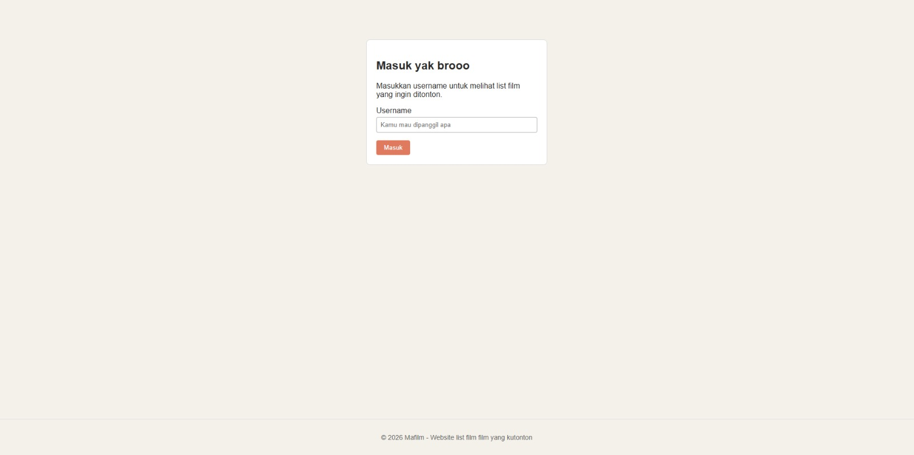
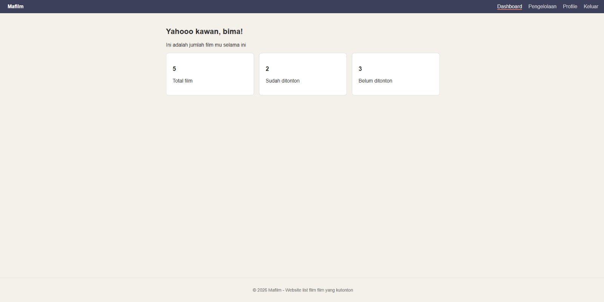
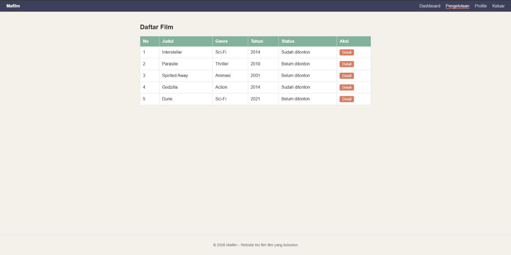
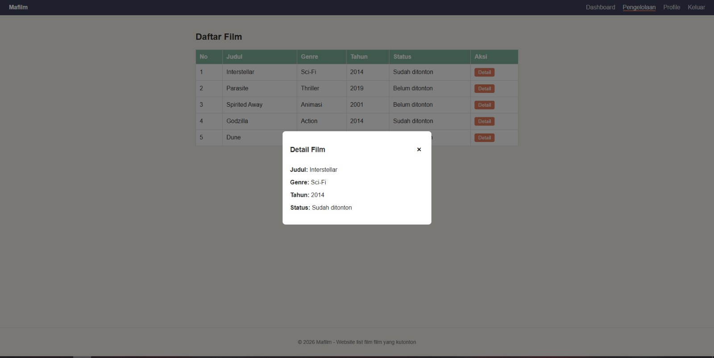
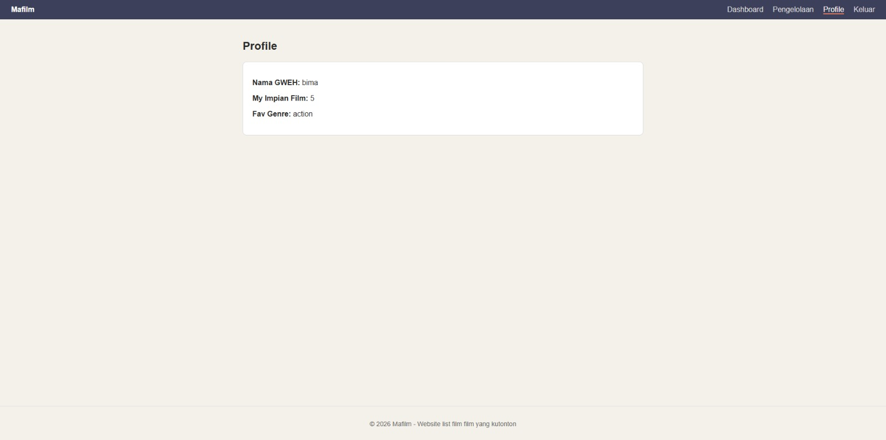

# Mafilm - Website List Film yang Ingin Ditonton

Tugas UTS Pemrograman Web. Mafilm adalah aplikasi web sederhana untuk mencatat film yang ingin atau sudah ditonton. Aplikasi dibuat dengan Laravel menggunakan arsitektur MVC dan sistem templating Blade, tanpa database (data film disimpan sebagai array di Controller).

## Identitas

- Nama: Bima Tri Kurniawan
- NIM: 252410103028
- Kelas: F
- Mata kuliah: Pemrograman Web

## Fitur

### Login
Halaman login simulasi (hanya mengisi username, tanpa password).



### Dashboard
Ringkasan jumlah film: total, sudah ditonton, dan belum ditonton.



### Pengelolaan
Daftar film dalam tabel yang ditampilkan dengan `@foreach`.



### Modal Detail
Popup detail film yang muncul saat tombol Detail diklik.



### Profile
Menampilkan username dan ringkasan wishlist.



## Teknologi

- PHP 8.3
- Laravel 12
- Blade Templating
- HTML, CSS, dan sedikit JavaScript

## Struktur File Utama

```
├── routes/
│   └── web.php
├── app/Http/Controllers/
│   └── PageController.php
├── resources/views/
│   ├── layouts/
│   │   └── app.blade.php
│   ├── login.blade.php
│   ├── dashboard.blade.php
│   ├── pengelolaan.blade.php
│   ├── profile.blade.php
│   └── components/
│       ├── navbar.blade.php
│       ├── footer.blade.php
│       └── modal.blade.php
└── public/css/
    └── style.css
```

## Alur Request-Response

1. Pengguna membuka `/`, lalu `PageController@login` menampilkan form login.
2. Form dikirim lewat method POST ke `/login`. Controller memvalidasi input, lalu melakukan redirect ke `/dashboard?username=...`.
3. Dashboard, Pengelolaan, dan Profile membaca `username` dari request parameter (`$request->query('username')`).
4. Link pada navbar selalu membawa parameter `username` agar tidak hilang saat berpindah halaman.
5. Data film dibuat di Controller, dikirim ke View, lalu ditampilkan dengan perulangan `@foreach`.
6. Jika `username` tidak ada, pengguna diarahkan kembali ke halaman login.

## Penerapan Blade

| Fitur Blade | Lokasi |
|---|---|
| `@extends` | semua view (login, dashboard, pengelolaan, profile) |
| `@section` dan `@yield` | view dan `layouts/app.blade.php` |
| `@include` | `layouts/app.blade.php` (memanggil footer) |
| `<x-navbar>` | `layouts/app.blade.php` |
| `<x-modal>` | `pengelolaan.blade.php` |
| `@foreach` | `pengelolaan.blade.php` |

## Catatan

- Aplikasi tidak memakai database, jadi `php artisan migrate` tidak perlu dijalankan.
- Login hanya simulasi: username apa pun (minimal 3 karakter) bisa masuk.

## Link

- Video demo: [link YouTube public]
